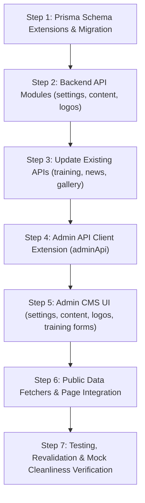

# ITSC Platform — Phase 3: CMS & Dynamic Content Architecture Implementation Plan

> **Document Type:** Implementation-Ready Architectural Plan  
> **Status:** APPROVED FOR PLANNING — READ-ONLY BASELINE  
> **Repository Impact:** ZERO code changes permitted in this planning task  
> **Date:** October 2026  
> **Authoritative Baseline:** `docs/cms-architecture.md`, `apps/api/prisma/schema.prisma`, `packages/shared/src/content.ts`

---

## 1. Executive Summary

The ITSC platform is a professional corporate technology-training and consultancy web application serving individual professionals, corporate teams, and governmental institutions in Ethiopia. It is built as a Turborepo monorepo comprising a Next.js 15 App Router frontend (`apps/web`), an Express 4.x TypeScript REST API backend (`apps/api`), and a shared contracts library (`packages/shared`).

In V1, ITSC is **strictly a dynamic content-managed website**, not a Learning Management System (LMS). There are no student logins, course enrollments, payments, exam engines, or gradebooks. The fundamental requirement of V1 is that **ITSC non-technical staff must be able to manage all agreed website content through the Admin Portal without developer intervention or code deployments**.

### Current State
1. **Security & RBAC (Phases 1 & 2):** Complete. Super Admin registration is locked, seed script is hardened, server-side Next.js route middleware protects `/admin/*`, and the Gallery module has full album and photo management.
2. **Existing Content Modules:** Training Programs/Categories, News Articles, and Gallery Albums/Images already have functional database models and Admin CRUD interfaces.
3. **The Architectural Gap:** Despite existing models, public pages still rely on mock data:
   - **Homepage, About, and Corporate Training:** 100% hardcoded to `apps/web/src/lib/mock/` files.
   - **Contact Information & Footer:** Read from static configuration and mock files with placeholder values (e.g., `+251 000 000 000`).
   - **Training Programs & News:** Public pages use server-side API clients with built-in fallbacks to mock data. Furthermore, `TrainingProgram` is missing `objectives` and `prerequisites` in the database, causing them to be rendered as empty arrays when data is fetched from the API.
   - **WebsiteSetting Model:** Exists in `schema.prisma` (`id, key, value Json`), but is completely orphaned — zero API endpoints, zero admin UI, and zero frontend usage.
   - **Partners / Client Logos:** Hardcoded arrays in `apps/web/src/lib/mock/homepage.ts`.

### Objective of Phase 3
Phase 3 bridges this gap by systematically replacing all remaining hardcoded and mock content with database-backed, admin-managed content flows. This plan details the exact data model adjustments, REST API contracts, Admin CMS screens, and Next.js data-fetching refactors needed to complete Phase 3 without overengineering.

---

## 2. Current CMS Architecture

The codebase currently exhibits a hybrid, two-tier architecture:

```
┌────────────────────────────────────────────────────────────────────────┐
│                          CURRENT ARCHITECTURE                          │
└────────────────────────────────────────────────────────────────────────┘

  ADMIN PORTAL (Client Components)
  ┌─────────────────┐ ┌────────────┐ ┌─────────────┐ ┌───────────────┐
  │ Training Admin  │ │ News Admin │ │Gallery Admin│ │Inquiries Admin│
  └────────┬────────┘ └─────┬──────┘ └──────┬──────┘ └───────┬───────┘
           │                │               │                │
           └────────────────┼───────────────┴────────────────┘
                            ▼ (REST + Bearer JWT)
  EXPRESS API (/api/v1)
  ┌──────────────────────────────────────────────────────────────────┐
  │ /training (CRUD)  |  /news (CRUD)  |  /gallery (CRUD)            │
  │ /contact/inquiries (CRUD)          |  /upload (Cloudinary/disk)  │
  └─────────────────────────┬────────────────────────────────────────┘
                            ▼
  PRISMA ORM -> POSTGRESQL DATABASE
  ┌──────────────────────────────────────────────────────────────────┐
  │ administrators, training_categories, training_programs,          │
  │ news_articles, gallery_albums, gallery_images,                   │
  │ contact_inquiries, website_settings [ORPHANED]                   │
  └──────────────────────────────────────────────────────────────────┘

  PUBLIC PAGES (App Router Server Components)
  ┌───────────────────────┐   ┌────────────────────────┐
  │ Training, News,       │   │ Home, About, Corporate,│
  │ Gallery Pages         │   │ Contact Info, Footer   │
  └──────────┬────────────┘   └───────────┬────────────┘
             │                            │
             ▼                            ▼
  ┌───────────────────────┐   ┌────────────────────────┐
  │ lib/api/fetchSafe     │   │ DIRECT IMPORT FROM     │
  │ (API with mock        │   │ lib/mock/*.ts          │
  │ fallback)             │   │ (100% hardcoded)       │
  └───────────────────────┘   └────────────────────────┘
```

### Architectural Deficiencies Identified:
1. **Asymmetric Data Flow:** Half of the public website connects to the API (with fallback), while the other half bypasses the API entirely to import mock TypeScript objects.
2. **Missing CMS Models:** No backend representation exists for Homepage sections, About content, Corporate Training offerings, Partners/Clients, or Site Settings.
3. **Data Shape Truncation:** The backend `TrainingProgram` schema lacks `objectives` and `prerequisites` fields present in the frontend `@itsc/shared` contract.
4. **Lack of Cache Invalidation:** Public data fetching uses `cache: "no-store"` across all server fetchers (`apps/web/src/lib/api/client.ts`), forcing all public pages into dynamic server-rendering (`ƒ`) on every request rather than utilizing Incremental Static Regeneration (ISR).

---

## 3. Source-of-Truth Analysis

For every public content area, the table below documents the reality of the current codebase:

| Content Area | Current Source of Truth | Current Frontend Source | Current Backend API | Current Prisma Model | Current Admin Interface | Status |
| :--- | :--- | :--- | :--- | :--- | :--- | :--- |
| **Homepage Hero** | `apps/web/src/lib/mock/homepage.ts` | Static import | None | None | None | **MOCK / STATIC** |
| **Homepage Stats** | `apps/web/src/lib/mock/homepage.ts` | Static import | None | None | None | **MOCK / STATIC** |
| **Homepage Services** | `apps/web/src/lib/mock/homepage.ts` | Static import | None | None | None | **MOCK / STATIC** |
| **Partner Logos** | `apps/web/src/lib/mock/homepage.ts` | Static import | None | None | None | **MOCK / STATIC** |
| **Client Logos** | `apps/web/src/lib/mock/homepage.ts` | Not rendered | None | None | None | **MOCK / UNUSED** |
| **Mission & Vision** | `apps/web/src/lib/mock/homepage.ts` | Static import | None | None | None | **MOCK / STATIC** |
| **Featured Training** | Database (with mock fallback) | `apps/web/src/lib/api/training.ts` | `GET /training/programs` | `TrainingProgram` | `/admin/training` | **IMPLEMENTED** |
| **Homepage CTA** | `apps/web/src/lib/mock/homepage.ts` | Static import | None | None | None | **MOCK / STATIC** |
| **About Hero & Values**| `apps/web/src/lib/mock/about.ts` | Static import | None | None | None | **MOCK / STATIC** |
| **Corporate Training** | `apps/web/src/lib/mock/corporate-training.ts` | Static import | None | None | None | **MOCK / STATIC** |
| **Training Programs** | Database (with mock fallback) | `apps/web/src/lib/api/training.ts` | `GET /training/programs` | `TrainingProgram` | `/admin/training` | **PARTIAL** (missing objectives/prereqs) |
| **News Articles** | Database (with mock fallback) | `apps/web/src/lib/api/news.ts` | `GET /news` | `NewsArticle` | `/admin/news` | **IMPLEMENTED** |
| **Gallery Albums** | Database (with mock fallback) | `apps/web/src/lib/api/gallery.ts` | `GET /gallery/albums` | `GalleryAlbum`, `GalleryImage` | `/admin/gallery` | **IMPLEMENTED** (Phase 2 completed UI) |
| **Contact Form** | Database (Prisma) | `apps/web/src/lib/api/contact.ts` | `POST /contact/inquiries` | `ContactInquiry` | `/admin/inquiries` | **IMPLEMENTED** |
| **Contact Info & Footer** | `siteConfig.ts` + `mock/contact.ts` | Static import | None | `WebsiteSetting` (orphaned) | None | **MOCK / STATIC** |
| **Website Settings** | None | None | None | `WebsiteSetting` | None | **ORPHANED MODEL** |

---

## 4. Alignment with `docs/cms-architecture.md`

`docs/cms-architecture.md` is the authoritative specification for the platform. The audit identified specific alignments and divergences:

### 4.1 Documented Requirements vs. Reality

1. **Section 3.1 & 3.2 — Individual Models vs. Structured Settings:**
   - *Documented Requirement:* Proposes separate Prisma models: `HomepageContent`, `Statistic`, `Service`, `PartnerLogo`, `ClientLogo`, `AboutContent`, `LeadershipMember`, `CorporateTrainingContent`, and `ContactInfo`.
   - *Current Implementation:* None of these models exist in `schema.prisma`. Only an open-ended `WebsiteSetting` model (`key`, `value Json`) exists.
   - *Evaluation & Recommendation:*
     - Creating 10 individual SQL tables for static page singletons (e.g. a 1-row table for `AboutContent`, a 1-row table for `CorporateTrainingContent`) introduces high schema migration overhead with minimal relational benefit.
     - However, **Partner/Trust Logos** represent a dynamic list that requires sorting, uploading, and active/inactive toggling. They deserve a dedicated model: `TrustLogo` (or `PartnerLogo`).
     - Singleton page sections (Hero, About text, Corporate training text, Contact metadata) are best housed in `WebsiteSetting` under strict, Zod-validated JSON keys (`homepage`, `about`, `corporate_training`, `contact_info`, `site_config`), maintaining strict data integrity through the API validation layer without overengineering the database schema.

2. **Section 3.3 — Training Requirements & Outcomes:**
   - *Documented Requirement:* Proposes `TrainingRequirement` and `LearningOutcome` as separate relation models.
   - *Current Implementation:* Missing entirely; `TrainingProgramDetail` in the frontend mock defines `objectives: string[]` and `prerequisites: string[]`.
   - *Evaluation & Recommendation:* Adding native PostgreSQL string arrays `objectives String[] @default([])` and `prerequisites String[] @default([])` to the `TrainingProgram` model is significantly cleaner and faster than creating two auxiliary join tables for simple bullet points.

3. **Section 3.5 — News Categories:**
   - *Documented Requirement:* Proposes `NewsCategory` and `NewsArticleCategory` join table.
   - *Current Implementation:* `NewsArticle` has no category relation; the frontend mapper hardcodes `category: "News"`.
   - *Evaluation & Recommendation:* For V1, adding an optional `category String? @db.VarChar(100)` field to `NewsArticle` satisfies the editorial requirement without the overhead of a full many-to-many taxonomy system.

4. **Section 3.8 & 3.9 — Media Library & AI Assistant:**
   - *Documented Requirement:* Proposes `KnowledgeDocument`, `AiAssistantConfig`, and `MediaAsset` models.
   - *Current Implementation:* Uploads are handled directly via Cloudinary / disk without database tracking (`upload.service.ts`). AI chat operates using a static JSON knowledge base (`data/knowledge.json`).
   - *Evaluation & Recommendation:* Phase 3 is focused on the **Website CMS**. Media management is already integrated via `ImageUploader` and `DocumentUploader`. Database-backed RAG and Media Asset management should be deferred to Phase 4 (AI & Advanced Tools) to prevent scope creep.

---

## 5. Prisma & Data Model Analysis

### 5.1 Content-Model Matrix

| Content Area | Existing Model | Required Action | Current Fields | Missing Fields to Add | Relations |
| :--- | :--- | :--- | :--- | :--- | :--- |
| **Training Programs** | `TrainingProgram` | Extend Model | `id, categoryId, authorId, title, slug, shortDescription, fullDescription, duration, deliveryMode, level, featuredImage, outlineText, outlineFileUrl, isFeatured, status, deletedAt, createdAt, updatedAt` | `objectives String[] @default([])`<br>`prerequisites String[] @default([])` | `author`, `category` |
| **News Articles** | `NewsArticle` | Extend Model | `id, authorId, title, slug, summary, content, featuredImage, publishedAt, status, deletedAt, createdAt, updatedAt` | `category String? @db.VarChar(100)` | `author` |
| **Gallery Albums** | `GalleryAlbum` | Extend Model | `id, title, slug, description, coverImage, createdAt, updatedAt` | `isFeatured Boolean @default(false)` | `images` |
| **Gallery Images** | `GalleryImage` | Extend Model | `id, albumId, imageUrl, caption, altText, uploadedAt` | `sortOrder Int @default(0)` | `album` |
| **Trust / Partner Logos** | None | **Create Model `TrustLogo`** | N/A | `id, name, logoUrl, websiteUrl, type (PARTNER/CLIENT), sortOrder, isActive, createdAt, updatedAt` | None |
| **Website Settings** | `WebsiteSetting` | **Activate & Retain** | `id, key, value Json, createdAt, updatedAt` | None (enforce Zod schema at API boundary) | None |

### 5.2 Specific Prisma Schema Additions Required in Phase 3

```prisma
// 1. Add fields to existing TrainingProgram
model TrainingProgram {
  // ... existing fields ...
  objectives       String[]         @default([])
  prerequisites    String[]         @default([])
  // ... existing relations and indexes ...
}

// 2. Add category to NewsArticle
model NewsArticle {
  // ... existing fields ...
  category         String?          @db.VarChar(100)
  // ... existing relations and indexes ...
}

// 3. Add isFeatured to GalleryAlbum
model GalleryAlbum {
  // ... existing fields ...
  isFeatured       Boolean          @default(false) @map("is_featured")
  // ...
}

// 4. Add sortOrder to GalleryImage
model GalleryImage {
  // ... existing fields ...
  sortOrder        Int              @default(0) @map("sort_order")
  // ...
}

// 5. Create new TrustLogo model
enum LogoType {
  PARTNER
  CLIENT
}

model TrustLogo {
  id               String           @id @default(uuid()) @db.Uuid
  name             String           @db.VarChar(150)
  logoUrl          String           @map("logo_url") @db.Text
  websiteUrl       String?          @map("website_url") @db.VarChar(500)
  type             LogoType         @default(PARTNER)
  sortOrder        Int              @default(0) @map("sort_order")
  isActive         Boolean          @default(true) @map("is_active")
  createdAt        DateTime         @default(now()) @map("created_at")
  updatedAt        DateTime         @updatedAt @map("updated_at")

  @@index([type, isActive])
  @@map("trust_logos")
}
```

---

## 6. Mock Data Inventory & Migration Map

Every mock file in `apps/web/src/lib/mock/` has been analyzed:

| Mock Source File | Consumers | Target API / Backend Model | Migration Strategy | Action on Completion |
| :--- | :--- | :--- | :--- | :--- |
| `mock/homepage.ts` | `apps/web/src/app/page.tsx` | `GET /content/homepage`<br>`WebsiteSetting` + `TrustLogo` | Fetch via server component; pass down typed props. | Keep as development fallback / seed source. |
| `mock/about.ts` | `apps/web/src/app/about/page.tsx` | `GET /content/about`<br>`WebsiteSetting ("about")` | Fetch via server component; pass down typed props. | Keep as development fallback / seed source. |
| `mock/corporate-training.ts` | `apps/web/src/app/corporate-training/page.tsx` | `GET /content/corporate-training`<br>`WebsiteSetting ("corporate_training")` | Fetch via server component; pass down typed props. | Keep as development fallback / seed source. |
| `mock/contact.ts` | `apps/web/src/app/contact/page.tsx` | `GET /content/contact-info`<br>`WebsiteSetting ("contact_info")` | Fetch contact details from API; wire form to existing API. | Keep as development fallback / seed source. |
| `mock/training.ts` | `apps/web/src/lib/api/training.ts` | `GET /training/programs`<br>`TrainingProgram` | Remove mock fallback in production; retain in local development mode. | Retain for local offline development. |
| `mock/news.ts` | `apps/web/src/lib/api/news.ts` | `GET /news`<br>`NewsArticle` | Remove mock fallback in production; retain in local development mode. | Retain for local offline development. |
| `mock/gallery.ts` | `apps/web/src/lib/api/gallery.ts` | `GET /gallery/albums`<br>`GalleryAlbum` | Remove mock fallback in production; retain in local development mode. | Retain for local offline development. |

### Development Seed vs. Production Data Separation Rule
- Production databases must **never** be initialized with hardcoded placeholder strings or fake telephone numbers (`+251 000 000 000`).
- A dedicated database seed script (`prisma/seed.content.ts`) will be created to read from sanitized mock data during local development (`NODE_ENV !== "production"`), populating categories, sample programs, and initial website settings.
- In production (`NODE_ENV === "production"`), the bootstrap seed only initializes the `SUPER_ADMIN` user and blank/default `WebsiteSetting` keys, leaving content authoring strictly to ITSC staff.

---

## 7. Public Page Content Analysis

### 7.1 Homepage (`apps/web/src/app/page.tsx`)
- **Hero Carousel:** Needs dynamic slides/hero from `WebsiteSetting ("homepage")`.
- **Partners Marquee:** Needs active partner logos from `GET /content/logos?type=PARTNER`.
- **Statistics Section:** Needs 4 key stats from `WebsiteSetting ("homepage")`.
- **Services Overview:** Needs 4 service cards from `WebsiteSetting ("homepage")`.
- **Featured Learning:** Already queries `getTrainingContent()`. Will immediately reflect database programs once published.
- **Mission & Vision ("Why ITSC"):** Needs mission and vision strings from `WebsiteSetting ("homepage")`.
- **Homepage CTA:** Needs title, subtitle, and CTA links from `WebsiteSetting ("homepage")`.

### 7.2 About Page (`apps/web/src/app/about/page.tsx`)
- **Page Hero:** Eyebrow, title, intro description.
- **Values Grid:** 5 core value articles (Title, Description, Icon identifier).
- **Page CTA:** Bottom CTA banner.
- All mapped directly from `WebsiteSetting ("about")`.

### 7.3 Corporate Training Page (`apps/web/src/app/corporate-training/page.tsx`)
- **Page Hero:** Eyebrow, title, intro, primary consultation link.
- **Benefits Section:** 4 benefit cards (Title, Description, Icon).
- **Corporate Programs:** 4 solution packages with capability lists.
- **Page CTA:** Bottom inquiry banner.
- All mapped directly from `WebsiteSetting ("corporate_training")`.

### 7.4 Contact Page (`apps/web/src/app/contact/page.tsx`) & Footer (`site-footer.tsx`)
- **Contact Details:** Official email, phone number, physical address, office hours, map link.
- **Social Links:** Facebook, Twitter/X, LinkedIn, YouTube, Telegram URLs.
- **Inquiry Form Subject Options:** Dropdown categories dynamically configured.
- Mapped from `WebsiteSetting ("contact_info")` and `WebsiteSetting ("site_config")`.

---

## 8. Admin CMS Gap Analysis & Information Architecture

### 8.1 Admin CMS Module Gap Matrix

| Admin Section | Current State | Missing Functionality | Phase 3 Scope |
| :--- | :--- | :--- | :--- |
| **Training Programs** | List, create, edit, delete categories & programs | `objectives` and `prerequisites` multi-string inputs | Add dynamic string array list editors to program form |
| **News & Events** | List, create, edit, delete articles with status | Category dropdown selection | Add category input field to form and table column |
| **Gallery** | List, create, edit albums; add, edit, delete photos | `isFeatured` toggle on album; image drag-and-drop sort | Add `isFeatured` switch to album modal; sortOrder field |
| **Contact Inquiries**| List, filter, view details, status update | Working response/notes field | Complete — minimal change needed |
| **Website Settings** | **DOES NOT EXIST** | Complete UI: branding, contact info, socials, footer | **Build `/admin/settings` with tabbed form** |
| **Content / Homepage**| **DOES NOT EXIST** | Hero, stats, services, mission/vision, CTA editor | **Build `/admin/content` (or sub-tabs in Settings)** |
| **Trust Logos** | **DOES NOT EXIST** | Logo list, upload, URL, partner/client toggle | **Build `/admin/logos` management screen** |

### 8.2 Recommended Admin Navigation Structure
To avoid overwhelming non-technical administrators with too many sidebar items, the navigation should be organized into clean operational groups:

```typescript
const adminNavigation = [
  // Overview
  { label: "Dashboard", href: "/admin", icon: LayoutDashboard },
  
  // Content Publishing
  { label: "Training Programs", href: "/admin/training", icon: BookOpen },
  { label: "News & Events", href: "/admin/news", icon: FileText },
  { label: "Gallery", href: "/admin/gallery", icon: Images },
  
  // Marketing & Pages
  { label: "Page Content", href: "/admin/content", icon: Layers }, // Home, About, Corporate tabs
  { label: "Partner & Client Logos", href: "/admin/logos", icon: Award },
  
  // Communications & Config
  { label: "Inquiries", href: "/admin/inquiries", icon: Inbox },
  { label: "Website Settings", href: "/admin/settings", icon: Settings }, // General, Contact, Socials
] as const;
```

---

## 9. Backend & API Plan

All new endpoints follow the established Express + Zod + AppError architecture, returning standard envelopes: `{ success: true, message: string, data: T }`.

### 9.1 New Module: `modules/settings/`
- **Location:** `apps/api/src/modules/settings/`
- **Endpoints:**
  - `GET /api/v1/settings/public` — Public (unauthenticated). Returns merged public settings (site info, contact details, social links).
  - `GET /api/v1/settings` — Admin (`authenticate`, `authorize("ADMIN", "SUPER_ADMIN")`). Returns all settings.
  - `PUT /api/v1/settings/:key` — Admin (`authenticate`, `authorize("ADMIN", "SUPER_ADMIN")`). Validates payload against Zod schema for `:key` and updates/upserts `WebsiteSetting`.

### 9.2 New Module: `modules/content/`
- **Location:** `apps/api/src/modules/content/`
- **Endpoints:**
  - `GET /api/v1/content/:page` (`homepage` | `about` | `corporate-training`) — Public. Returns structured page data.
  - `PUT /api/v1/content/:page` — Admin (`authenticate`, `authorize("ADMIN", "SUPER_ADMIN", "CONTENT_EDITOR")`). Validates and stores content in `WebsiteSetting`.

### 9.3 New Module: `modules/logos/`
- **Location:** `apps/api/src/modules/logos/`
- **Endpoints:**
  - `GET /api/v1/logos?type=PARTNER|CLIENT` — Public. Returns active logos sorted by `sortOrder asc`.
  - `GET /api/v1/logos/admin` — Admin. Returns all logos (including inactive).
  - `POST /api/v1/logos` — Admin (`authenticate`, `authorize("ADMIN", "SUPER_ADMIN")`).
  - `PATCH /api/v1/logos/:id` — Admin.
  - `DELETE /api/v1/logos/:id` — Admin.

### 9.4 Enhancements to Existing Modules
- `apps/api/src/modules/training/`: Update `createProgramSchema` and `updateProgramSchema` to accept `objectives: z.array(z.string()).optional()` and `prerequisites: z.array(z.string()).optional()`. Update `training.service.ts` to persist them to Postgres.
- `apps/api/src/modules/news/`: Update schema and service to handle `category: z.string().optional()`.
- `apps/api/src/modules/gallery/`: Update schema and service to handle `isFeatured: z.boolean().optional()` on albums and `sortOrder: z.number().int().optional()` on images.

---

## 10. Frontend Data Flow Plan

### 10.1 App Router Rendering Strategy
- **Public Pages are Server Components (`RSC`):** Data is fetched directly on the server during request handling or build time.
- **Cache Strategy:** Transition from hardcoded `cache: "no-store"` to Next.js tag-based revalidation:
  ```typescript
  fetch(`${siteConfig.apiUrl}/content/homepage`, {
    next: { tags: ["content-homepage"], revalidate: 3600 } // ISR with 1 hour fallback
  });
  ```
- **On-Demand Cache Invalidation:** Add an internal Next.js route handler (`/api/revalidate`) or trigger revalidation from Server Actions so that when an administrator saves content in the Admin Portal, public page caches are purged instantly.

### 10.2 Client-Side Admin Portal Flow
- All admin pages remain `"use client"` components utilizing `adminApi` in `apps/web/src/lib/admin/api.ts`.
- Form state is managed with controlled React state, providing instant validation feedback, loading spinners, and error alerts matching the existing design system.

---

## 11. Media & Image Strategy

The upload pipeline established in `apps/api/src/modules/upload/upload.service.ts` is solid:
- Supports Cloudinary (production) with automated local disk fallback (`uploads/`).
- Enforces 10 MB file limits and MIME type whitelisting (JPEG, PNG, WebP, GIF, AVIF for images; PDF, DOCX for documents).

### CMS Integration Requirements:
1. **Logo Uploads:** Must support transparent PNGs and SVGs (need to ensure SVG is safely sanitized or restricted to trusted admins).
2. **Featured Images:** Every training course, news article, and gallery cover connects via the standard `ImageUploader` component.
3. **Alt Text Enforcement:** Accessibility is maintained by requiring descriptive `altText` across all media entries.

---

## 12. Content Lifecycle & Publishing Workflow

To prevent overengineering, V1 will utilize a lean, three-state lifecycle model:
- `DRAFT`: Content is editable in admin; never returned by public APIs.
- `PUBLISHED`: Visible immediately on public pages.
- `ARCHIVED`: Hidden from public views; preserved in database for administrative records.

| Content Type | Lifecycle Supported in V1 | Ordering Mechanism |
| :--- | :--- | :--- |
| **Training Programs** | DRAFT / PUBLISHED / ARCHIVED | Category grouping + `isFeatured` flag |
| **News Articles** | DRAFT / PUBLISHED / ARCHIVED | `publishedAt` descending |
| **Gallery Albums** | Direct Publish / Delete | `createdAt` descending + `isFeatured` flag |
| **Trust Logos** | Active / Inactive boolean | Integer `sortOrder` ascending |
| **Page Content** | Direct Save (instant live) | Natural section ordering |
| **Website Settings** | Direct Save (instant live) | Key-value mapping |

---

## 13. Dynamic SEO Implications

For dynamic CMS-backed pages, metadata must be generated using Next.js `generateMetadata`:

```typescript
export async function generateMetadata({ params }): Promise<Metadata> {
  const data = await getTrainingProgram(params.slug);
  if (!data) return { title: "Program Not Found" };

  return {
    title: `${data.title} | ITSC Training`,
    description: data.shortDescription,
    openGraph: {
      title: data.title,
      description: data.shortDescription,
      images: data.featuredImage ? [{ url: data.featuredImage.src }] : [],
      type: "website"
    }
  };
}
```

Dynamic JSON-LD structured data (`Course`, `NewsArticle`, `Organization`) will be injected on detail pages to maximize search engine indexing in Ethiopia and regionally.

---

## 14. Security & RBAC Enforcement

All Phase 3 write operations must strictly adhere to the RBAC model verified in Phase 1:

| Operation | Route | Allowed Roles |
| :--- | :--- | :--- |
| Public Read Content | `GET /api/v1/content/*`, `GET /api/v1/settings/public`, `GET /api/v1/logos` | Public (Unauthenticated) |
| Manage Page Content | `PUT /api/v1/content/*` | `SUPER_ADMIN`, `ADMIN`, `CONTENT_EDITOR` |
| Manage Website Settings | `PUT /api/v1/settings/*` | `SUPER_ADMIN`, `ADMIN` |
| Manage Trust Logos | `POST/PATCH/DELETE /api/v1/logos/*` | `SUPER_ADMIN`, `ADMIN` |
| Manage Training Content | `POST/PATCH/DELETE /api/v1/training/*` | `SUPER_ADMIN`, `ADMIN`, `TRAINING_MANAGER` |
| Manage News Articles | `POST/PATCH/DELETE /api/v1/news/*` | `SUPER_ADMIN`, `ADMIN`, `NEWS_EDITOR` |

Backend Express middleware (`authenticate`, `authorize(...)`) enforces this at the HTTP controller boundary; frontend layout guards (`apps/web/src/middleware.ts`) protect edge routes.

---

## 15. File-Level Implementation Map

When Phase 3 execution is authorized, the following concrete file changes will be made:

```
apps/api/
  prisma/
    schema.prisma                         [MODIFY: Add objectives, prereqs, TrustLogo, fields]
    migrations/                           [NEW MIGRATION via prisma migrate dev]
    seed.content.ts                       [NEW: Development content seed script]
  src/
    modules/
      settings/                           [NEW MODULE]
        settings.routes.ts
        settings.controller.ts
        settings.service.ts
        settings.schema.ts
      content/                            [NEW MODULE]
        content.routes.ts
        content.controller.ts
        content.service.ts
        content.schema.ts
      logos/                              [NEW MODULE]
        logos.routes.ts
        logos.controller.ts
        logos.service.ts
        logos.schema.ts
      training/                           [MODIFY: Add objectives & prereqs handling]
        training.schema.ts
        training.service.ts
      news/                               [MODIFY: Add category handling]
        news.schema.ts
        news.service.ts
      gallery/                            [MODIFY: Add isFeatured & sortOrder handling]
        gallery.schema.ts
        gallery.service.ts
      index.ts                            [MODIFY: Mount /settings, /content, /logos]

apps/web/
  src/
    lib/
      admin/
        api.ts                            [MODIFY: Add settings, content, logo CRUD methods]
      api/
        content.ts                        [NEW: Server-side public fetchers for pages]
        logos.ts                          [NEW: Server-side public fetchers for logos]
        settings.ts                       [NEW: Server-side public fetchers for settings]
        training.ts                       [MODIFY: Pass objectives & prereqs from API]
        news.ts                           [MODIFY: Pass category from API]
    app/
      admin/
        layout.tsx                        [MODIFY: Add Settings, Content, Logos navigation]
        settings/page.tsx                 [NEW: Admin settings management page]
        content/page.tsx                  [NEW: Admin page content management page]
        logos/page.tsx                    [NEW: Admin partner/client logo management page]
        training/page.tsx                 [MODIFY: Add objectives & prereqs editors]
      page.tsx                            [MODIFY: Consume API for hero, stats, services, CTA]
      about/page.tsx                      [MODIFY: Consume API for about content & values]
      corporate-training/page.tsx         [MODIFY: Consume API for corporate content]
      contact/page.tsx                    [MODIFY: Consume API for contact details]
      components/
        layout/
          site-footer.tsx                 [MODIFY: Consume dynamic settings for links/contact]
```

---

## 16. Phased Implementation Sequence



### Dependency Order:
1. **Task 3.1: Data Model Updates (Prisma)**
   - Add fields to `schema.prisma`. Run migration.
   - *Risk:* Low. Only additive fields with default values.
2. **Task 3.2: Backend Content & Settings Modules**
   - Implement `modules/settings`, `modules/content`, `modules/logos`.
   - Update `modules/training` for array fields.
   - *Risk:* Low. Follows existing Express controller/service patterns.
3. **Task 3.3: Admin Client & Navigation**
   - Add API methods in `apps/web/src/lib/admin/api.ts`.
   - Add sidebar entries in `apps/web/src/app/admin/layout.tsx`.
   - *Risk:* Low.
4. **Task 3.4: Admin Management Screens**
   - Build `/admin/settings`, `/admin/content`, `/admin/logos`.
   - Update `/admin/training` to support objectives and prerequisites.
   - *Risk:* Medium. Form validation and UI state management.
5. **Task 3.5: Public Website Integration**
   - Connect `page.tsx`, `about/page.tsx`, `corporate-training/page.tsx`, `contact/page.tsx`, and `site-footer.tsx` to database-backed fetchers.
   - *Risk:* Low. Shared interfaces in `@itsc/shared` already match the required shapes.
6. **Task 3.6: Verification & Polish**
   - Verify dynamic updates appear on public pages.
   - Run typechecks and Next.js production builds.

---

## 17. Task-by-Task Estimates

| Task ID | Task Description | Files Touched | Est. Hours | Risk |
| :--- | :--- | :--- | :--- | :--- |
| **P3-01** | Prisma schema extensions & DB migration | `schema.prisma`, `migrations/` | 1.5 h | Low |
| **P3-02** | Backend Settings module (`/api/v1/settings`) | `apps/api/src/modules/settings/*` | 2.5 h | Low |
| **P3-03** | Backend Page Content module (`/api/v1/content`) | `apps/api/src/modules/content/*` | 2.5 h | Low |
| **P3-04** | Backend Logos module (`/api/v1/logos`) | `apps/api/src/modules/logos/*` | 2.0 h | Low |
| **P3-05** | Training Program schema/service update | `apps/api/src/modules/training/*` | 1.5 h | Low |
| **P3-06** | Admin API client methods extension | `apps/web/src/lib/admin/api.ts` | 1.5 h | Low |
| **P3-07** | Admin Website Settings UI | `apps/web/src/app/admin/settings/*` | 4.0 h | Medium |
| **P3-08** | Admin Page Content UI (Home/About/Corporate) | `apps/web/src/app/admin/content/*` | 4.5 h | Medium |
| **P3-09** | Admin Logos UI (Partners & Clients) | `apps/web/src/app/admin/logos/*` | 2.5 h | Low |
| **P3-10** | Admin Training form objectives/prereqs editor| `apps/web/src/app/admin/training/*`| 2.0 h | Low |
| **P3-11** | Public Homepage API integration | `apps/web/src/app/page.tsx`, fetchers | 2.5 h | Low |
| **P3-12** | Public About & Corporate Page API integration| `apps/web/src/app/{about,corporate-training}/*` | 2.0 h | Low |
| **P3-13** | Public Contact & Footer API integration | `contact/page.tsx`, `site-footer.tsx` | 2.0 h | Low |
| **P3-14** | End-to-end testing, typecheck & build check | Entire monorepo | 2.0 h | Low |
| **TOTAL**| **Full Phase 3 Implementation** | | **33.0 h** | |

---

## 18. Acceptance Criteria

Phase 3 will be considered complete when:
1. **Zero Hardcoded Mock Content on Core Pages:** No public page (`/`, `/about`, `/corporate-training`, `/contact`, `/training-programs`, `/news`, `/gallery`) relies on static mock data when the database is available.
2. **Admin Controllability:** An administrator can log into `/admin` and update:
   - Homepage hero, statistics, services, and CTA.
   - Partner and client logo images and links.
   - About story and values.
   - Corporate training offerings and benefits.
   - Contact phone numbers, email addresses, and social links.
   - Training programs including learning objectives and prerequisites.
3. **Data Integrity & Validation:** Every backend write endpoint validates request bodies using Zod schemas with descriptive error codes.
4. **Security Enforcement:** All write operations require valid JWT authentication and role authorization (`SUPER_ADMIN` or authorized administrative role).
5. **No Regressions:** Phase 1 security hardening and Phase 2 gallery image upload workflows remain 100% operational.
6. **Clean Typechecks & Builds:** `npm run typecheck` and `npm run build --workspace=web` pass with exit code `0`.

---

## 19. Risks and Mitigations

| Identified Risk | Impact | Mitigation |
| :--- | :--- | :--- |
| **Database connection failure in dev** | Public pages break if API is offline | Retain `apiFetchSafe` fallback pattern so local UI development can proceed even without a live DB connection. |
| **Large JSON corruption in WebsiteSetting** | Breaking public page rendering | Validate JSON payloads with strict Zod schemas on both frontend and backend before writing to DB. |
| **Overengineering CMS components** | Unmaintainable abstractions | Do not build generic block builders or schema engines. Use explicit, typed, single-purpose form screens for each page section. |
| **CRLF / Git line-ending churn** | Messy diffs in Windows environment | Perform precise surgical edits preserving existing file formatting. |

---

## 20. Open Questions & Architectural Decisions Required

Before implementing Phase 3, the following decisions should be confirmed:
1. **Logo Storage:** Do you prefer storing Partner/Client logos in a dedicated `TrustLogo` table (recommended for drag-and-drop sorting and toggling) or inside `WebsiteSetting` JSON?
2. **Revalidation Strategy:** Should public pages use standard 1-hour time-based ISR (`revalidate = 3600`), or do you require immediate on-demand tag revalidation upon clicking "Save" in admin?
3. **Admin Page Content UI:** Should Homepage, About, and Corporate Training content be managed under a unified `/admin/content` page with sub-tabs, or separated into individual top-level admin routes? (Recommended: unified `/admin/content` with tabs).

---

## 21. Definition of Done

Phase 3 is complete when:
- All database migrations are applied.
- All planned API endpoints return valid HTTP responses and pass typechecks.
- All admin management interfaces allow creating, updating, and saving content without error.
- All public pages render dynamic content directly from the API.
- The build succeeds (`next build` exit code 0).
- The repository is clean and ready for Phase 4.

---

## PHASE 3 PLAN STATUS

- **Repository source files modified:** 0 (READ-ONLY PLANNING MODE OBSERVED)
- **Repository source files deleted:** 0
- **Repository source files renamed/moved:** 0
- **Database changes:** 0
- **Migrations executed:** 0
- **Packages installed:** 0
- **Planning artifact created:** 1 (`ITSC_PHASE_3_CMS_IMPLEMENTATION_PLAN.md`)
