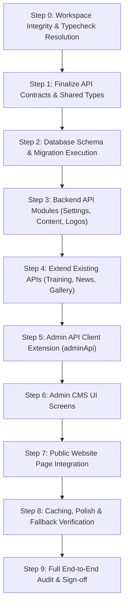

# ITSC Platform — Phase 3: CMS & Dynamic Content Architecture
## Readiness Audit & Pre-Implementation Verification Report

> **Document Type:** Principal Architecture & Security Audit  
> **Phase:** Phase 3 — CMS & Dynamic Content Architecture  
> **Auditor Roles:** Principal Software Architect, Senior Full-Stack Engineer, Database Migration Reviewer, Application Security Auditor  
> **Date:** October 17, 2026  
> **Audit Status:** READ-ONLY AUDIT COMPLETE  
> **Repository Impact:** ZERO code changes executed. Zero destructive Git actions. Zero schema migrations applied.  

---

## 1. Executive Verdict

### **VERDICT: NOT READY FOR DIRECT EXECUTION (READY WITH CONDITIONS)**

The ITSC platform has a sound architectural foundation and well-constructed Phase 1 (Security Hardening) and Phase 2 (Gallery Image Management + Accessibility) modifications. However, **Phase 3 implementation cannot be authorized immediately** due to three critical pre-conditions identified during this audit:

1. **Premature Workspace Inconsistencies:** During an unauthorized execution attempt by a previous session, four files were created in `apps/api/src/modules/settings/`, and `apps/api/prisma/schema.prisma` was modified in the working tree. Crucially, the settings module introduces **two blocking TypeScript compilation errors** (`TS2554` and `TS2322`), causing `npm run typecheck` in `apps/api` to fail.
2. **Database Migration Disconnect:** The working tree `schema.prisma` contains new models and fields (`TrustLogo`, `LogoType`, `objectives`, `prerequisites`, `category`, `isFeatured`, `sortOrder`), and the Prisma client was locally re-generated, but **no database migration has been executed** against PostgreSQL. Prisma Migrate currently fails with connection issues (`P1001`/`P1012`) against the pooler endpoint when invoked via the CLI without explicit direct connection configuration.
3. **Cache & Invalidation Contract Undefined:** The frontend App Router currently enforces `cache: "no-store"` across all server fetchers. The proposed transition to Next.js tag-based ISR lacks a secured webhook/endpoint contract to bridge the decoupled Express backend (`apps/api`) and Next.js frontend (`apps/web`).

Once these conditions are resolved according to the safe sequence defined in this report, Step 1 of Phase 3 can be safely authorized.

---

## 2. Verified Repository State

### 2.1 Git Status & Diff Summary

Inspection executed via `git status --short`, `git diff --stat`, and `git diff --check`:

```text
Working Tree State:
 M apps/api/package.json
 M apps/api/prisma/schema.prisma
 M apps/api/prisma/seed.ts
 M apps/api/src/modules/auth/auth.routes.ts
 M apps/web/src/app/admin/gallery/page.tsx
 M apps/web/src/components/contact/contact-form.tsx
 M apps/web/src/lib/admin/api.ts
?? apps/api/src/modules/settings/ (4 untracked files)
```

**Git Diff Stat:**
- `apps/api/package.json`: 3 lines changed (+2, -1) — adds `"auth:bootstrap": "tsx prisma/seed.ts"` alias.
- `apps/api/prisma/schema.prisma`: 49 lines changed (+43, -6) — working tree additions for Phase 3 (unmigrated).
- `apps/api/prisma/seed.ts`: 20 lines changed (+13, -7) — hardened bootstrap seed with environment variable guard and production checks.
- `apps/api/src/modules/auth/auth.routes.ts`: 5 lines changed (+3, -2) — locks `/register` behind `authenticate` and `authorize("SUPER_ADMIN")`.
- `apps/web/src/app/admin/gallery/page.tsx`: 422 lines changed (+389, -33) — complete Phase 2 album & image management interface with `exactOptionalPropertyTypes` compatibility.
- `apps/web/src/components/contact/contact-form.tsx`: 2 lines changed (+1, -1) — fixes WCAG contrast by replacing `text-white` with `text-brand-navy` on `bg-brand-gold` button (~6.4:1 contrast ratio).
- `apps/web/src/lib/admin/api.ts`: 38 lines changed (+38, -0) — adds `GalleryAlbumWithImages` interface and 4 gallery image CRUD API methods.

### 2.2 Verification of `apps/web/src/components/ui/card.tsx`

- **Command Executed:** `git diff -- apps/web/src/components/ui/card.tsx`
- **Result:** **ZERO DIFF.** The file matches `HEAD` byte-for-byte.
- **Verification:** Inspection of `git show HEAD:apps/web/src/components/ui/card.tsx` confirmed that the single-character leading space on line 1 (`" import"`) was completely eliminated. The file is clean and requires no action.

### 2.3 Phase 1 & Phase 2 Integrity Check

- **Phase 1 (Security Hardening):**
  - Registration route `/api/v1/auth/register` is locked behind `SUPER_ADMIN` RBAC.
  - Automated test suite `apps/api/test/auth-rbac.test.ts` was executed: **7 of 7 tests passed** with 0 failures.
  - Seed script contains production guard throwing an error if weak or default credentials are provided in `production`.
- **Phase 2 (Gallery & Accessibility):**
  - `apps/web/src/app/admin/gallery/page.tsx` compiles cleanly with `exactOptionalPropertyTypes: true` and `noUncheckedIndexedAccess: true`.
  - Next.js production build (`npm run build --workspace=web`) completed with **Exit Code 0** across all 19 application routes.
  - Submit button contrast meets WCAG AA standards.

---

## 3. Review of the Phase 3 Implementation Plan

The proposal in `ITSC_PHASE_3_CMS_IMPLEMENTATION_PLAN.md` was subjected to architectural scrutiny across its five core components:

### Proposal A: `WebsiteSetting` JSON Configuration
*Stores singleton page content (`homepage`, `about`, `corporate_training`, `contact_info`, `site_config`) in the existing `WebsiteSetting` model using strict Zod schemas.*

1. **Exact Problem Solved:** Eliminates hardcoded mock imports in `page.tsx`, `about/page.tsx`, `corporate-training/page.tsx`, `contact/page.tsx`, and `site-footer.tsx` without creating 10 single-row relational database tables.
2. **Dependencies:** `apps/api/src/modules/settings/`, `apps/api/src/modules/content/`, `packages/shared/src/content.ts`, public frontend page components.
3. **Necessity for V1:** **CRITICAL.** Staff cannot edit page copy without code deployment if this is omitted.
4. **Simpler Alternative:** None that maintains CMS capabilities. Creating individual SQL tables for static singleton pages (`AboutHero`, `CorporateIntro`, etc.) adds excessive relational scaffolding for zero relational gain.
5. **Backward-Compatibility Risks:** If stored JSON deviates from expected keys, frontend rendering could crash unless safeguarded by Zod parse/fallback mechanisms.
6. **Validation & Authorization:** Strict Zod schema validation per key at the API boundary; write operations restricted to `SUPER_ADMIN`, `ADMIN`, and `CONTENT_EDITOR`.
7. **Testing:** Unit tests verifying valid/invalid JSON payloads; frontend fallback tests when database returns null.
8. **Rollback Strategy:** Clear or revert the specific key in `WebsiteSetting`; pages automatically fall back to baseline mock objects.

---

### Proposal B: Dedicated `TrustLogo` Model
*Creates a dedicated relational model for partner and client logos (`id, name, logoUrl, websiteUrl, type, sortOrder, isActive, createdAt, updatedAt`).*

1. **Exact Problem Solved:** Partner logos in the homepage marquee (`PartnerMarquee`) and future client lists currently require developer editing in `apps/web/src/lib/mock/homepage.ts`.
2. **Dependencies:** `schema.prisma`, `TrustLogo` CRUD module, `apps/web/src/app/admin/logos/page.tsx`, `apps/web/src/components/sections/partner-marquee.tsx`.
3. **Necessity for V1:** **HIGH.** Corporate training partnerships change frequently; non-technical administrators need to add, hide, or reorder logos.
4. **Simpler Alternative:** Storing logos inside the `homepage` JSON setting. **Rejected:** Storing an array of items with binary image uploads, URL fields, sorting integers, and active toggles inside a single JSON blob makes reordering, individual image uploading, and client/partner separation error-prone and unwieldy for admin UI forms.
5. **Backward-Compatibility Risks:** None. Fully additive model.
6. **Validation & Authorization:** URL validation on `logoUrl` (must be HTTPS or local upload path); `websiteUrl` optional HTTPS; role restricted to `SUPER_ADMIN` and `ADMIN`.
7. **Testing:** Integration tests for sorting, filtering by `type=PARTNER|CLIENT`, and verifying inactive logos are excluded from public responses.
8. **Rollback Strategy:** Drop table `trust_logos` via rollback migration; restore static marquee array.

---

### Proposal C: `TrainingProgram` Objectives & Prerequisites
*Adds `objectives String[] @default([])` and `prerequisites String[] @default([])` to `TrainingProgram`.*

1. **Exact Problem Solved:** Detail pages (`/training-programs/[slug]`) display empty bullet lists under "Learning Objectives" and "Prerequisites" when reading from the database because the database schema lacks these fields, forcing `toDetail()` in `apps/web/src/lib/api/training.ts` to return empty arrays `[]`.
2. **Dependencies:** `schema.prisma`, `training.schema.ts`, `training.service.ts`, `apps/web/src/lib/api/training.ts`, `apps/web/src/app/admin/training/page.tsx`.
3. **Necessity for V1:** **CRITICAL.** Professional training course pages are incomplete without clear objectives and prerequisites.
4. **Simpler Alternative:** PostgreSQL native string arrays (`String[]`) are the simplest, cleanest implementation. Auxiliary relation tables (`TrainingObjective`, `TrainingPrerequisite`) would introduce unnecessary JOINs and multi-table cascading writes for simple bullet lists.
5. **Backward-Compatibility Risks:** None. `@default([])` guarantees existing programs remain valid with zero downtime.
6. **Validation & Authorization:** Zod validation: `z.array(z.string().min(2).max(255)).default([])`; write operations restricted to `TRAINING_MANAGER`, `ADMIN`, `SUPER_ADMIN`.
7. **Testing:** Verify creation and update of programs with empty, single, and multiple bullet points; verify public display on detail page.
8. **Rollback Strategy:** Remove columns via migration; `toDetail()` falls back to `[]`.

---

### Proposal D: Admin Interfaces (`/admin/content`, `/admin/logos`, `/admin/settings`)
*Builds dedicated UI screens in the Admin Portal for managing page copy, logos, and global site settings.*

1. **Exact Problem Solved:** The Admin Portal currently has interfaces only for Training, News, Gallery, and Inquiries. Staff have no screen to update copy or settings.
2. **Dependencies:** `apps/web/src/app/admin/layout.tsx` (navigation), `apps/web/src/lib/admin/api.ts` (API methods), UI component library (`@/components/ui/*`).
3. **Necessity for V1:** **CRITICAL.** An API without an admin UI fails the primary product requirement of V1.
4. **Simpler Alternative:** Unified `/admin/content` page with sub-tabs (`Homepage`, `About`, `Corporate Training`) rather than three separate top-level pages.
5. **Backward-Compatibility Risks:** None. Only adds new admin routes protected by session auth.
6. **Validation & Authorization:** Frontend form validation mirror backend Zod schemas; requests accompanied by `Bearer <JWT>`.
7. **Testing:** Interactive manual testing of form input, upload integration, toast alerts, error boundaries, and persistence.
8. **Rollback Strategy:** Delete new page folders; remove sidebar navigation links.

---

### Proposal E: Next.js Cache Invalidation via Tags
*Transitioning from `cache: "no-store"` to tag-based ISR (`next: { tags: ["content-homepage"], revalidate: 3600 }`).*

1. **Exact Problem Solved:** Current `cache: "no-store"` forces all public pages into dynamic server-rendering (`ƒ`) on every single visitor request, incurring unnecessary database and backend load for mostly static marketing content.
2. **Dependencies:** `apps/web/src/lib/api/client.ts`, Next.js App Router cache, backend invalidation webhook.
3. **Necessity for V1:** **MEDIUM-LOW.** While desirable for performance, `cache: "no-store"` is currently functional and guarantees instant content freshness. Tag-based invalidation between decoupled Express and Next.js requires webhook authentication and failure handling.
4. **Simpler Alternative:** **Recommended for Phase 3 V1:** Use short time-based revalidation (`revalidate: 60` or `300`) or keep `cache: "no-store"` initially, deferring cross-server webhook invalidation to Phase 3 Polish.
5. **Backward-Compatibility Risks:** If tag revalidation fails, public users see stale content indefinitely.
6. **Validation & Authorization:** Revalidation endpoint must require a shared secret header (`x-revalidate-secret`).
7. **Testing:** Verify cache hits, trigger invalidation, and confirm immediate cache purge.
8. **Rollback Strategy:** Revert `apps/web/src/lib/api/client.ts` to `cache: "no-store"`.

---

## 4. Database & Migration Assessment

### 4.1 Prisma Schema & History Analysis

The database currently runs on PostgreSQL (hosted on Neon). The migration history in `apps/api/prisma/migrations/` consists of three executed migrations:
1. `20260809055241_itsc_initial_migration`: Created base tables including `administrators`, `training_categories`, `training_programs`, `news_articles`, `gallery_albums`, `gallery_images`, `contact_inquiries`, and `website_settings`.
2. `20260921000000_add_contact_inquiry_origin`: Added `source_page` and `source_label` to `contact_inquiries`.
3. `20260921010000_add_training_program_outline`: Added `outline_text` and `outline_file_url` to `training_programs`.

### 4.2 Status of `WebsiteSetting`

- **Finding:** `WebsiteSetting` **already exists** in PostgreSQL.
- **Table Definition (from migration 1):**
  ```sql
  CREATE TABLE "website_settings" (
      "id" UUID NOT NULL,
      "key" VARCHAR(120) NOT NULL,
      "value" JSONB NOT NULL,
      "created_at" TIMESTAMP(3) NOT NULL DEFAULT CURRENT_TIMESTAMP,
      "updated_at" TIMESTAMP(3) NOT NULL,
      CONSTRAINT "website_settings_pkey" PRIMARY KEY ("id")
  );
  CREATE UNIQUE INDEX "website_settings_key_key" ON "website_settings"("key");
  ```
- **Implication:** No table creation or schema migration is needed for `WebsiteSetting`. It is ready to receive structured JSON under keys `homepage`, `about`, `corporate_training`, `contact_info`, and `site_config`.

### 4.3 Proposed Schema Modifications

The proposed schema changes are **100% additive and backward-compatible**:

```prisma
// --- TrainingProgram Extensions ---
model TrainingProgram {
  // Existing fields...
  objectives       String[]         @default([])
  prerequisites    String[]         @default([])
  // Existing relations...
}

// --- NewsArticle Extension ---
model NewsArticle {
  // Existing fields...
  category         String?          @db.VarChar(100)
  // Index addition
  @@index([category])
}

// --- Gallery Extensions ---
model GalleryAlbum {
  // Existing fields...
  isFeatured       Boolean          @default(false) @map("is_featured")
}

model GalleryImage {
  // Existing fields...
  sortOrder        Int              @default(0) @map("sort_order")
  @@index([albumId, sortOrder])
}

// --- New TrustLogo Model ---
enum LogoType {
  PARTNER
  CLIENT
}

model TrustLogo {
  id               String           @id @default(uuid()) @db.Uuid
  name             String           @db.VarChar(150)
  logoUrl          String           @map("logo_url") @db.Text
  websiteUrl       String?          @map("website_url") @db.Text
  type             LogoType         @default(PARTNER)
  sortOrder        Int              @default(0) @map("sort_order")
  isActive         Boolean          @default(true) @map("is_active")
  createdAt        DateTime         @default(now()) @map("created_at")
  updatedAt        DateTime         @updatedAt @map("updated_at")

  @@index([type, isActive])
  @@map("trust_logos")
}
```

### 4.4 Migration Safety & CLI Diagnostics

1. **Destructive Operation Risk:** **ZERO.** No tables are dropped, no existing columns are renamed or deleted, and all new columns have default values (`@default([])`, `@default(false)`, `@default(0)`) or are nullable (`String?`).
2. **Neon Pooled Connection Consideration:**
   - Testing confirmed direct TCP connectivity to port 5432.
   - However, Neon's PgBouncer connection pooler (`-pooler` in connection string) interferes with Prisma Migrate's shadow database and session advisory locking.
   - **Requirement for Migration Step:** When running `npx prisma migrate dev`, the direct, unpooled endpoint (`DATABASE_URL` without `-pooler`) or explicit `DIRECT_URL` must be used to ensure seamless DDL execution.

---

## 5. Authorization, Validation & Security Architecture

### 5.1 Role-Based Access Control (RBAC) Matrix

The system uses the existing `AdminRole` enum: `SUPER_ADMIN`, `ADMIN`, `CONTENT_EDITOR`, `TRAINING_MANAGER`, `NEWS_EDITOR`, `VIEWER`.

| Content Domain | Endpoint Route | Read Access | Create/Update Access | Delete Access |
| :--- | :--- | :--- | :--- | :--- |
| **Public Settings** | `GET /api/v1/settings/public` | Public (Unauthenticated) | N/A | N/A |
| **Website Settings** | `GET /api/v1/settings`, `PUT /api/v1/settings/:key` | `SUPER_ADMIN`, `ADMIN` | `SUPER_ADMIN`, `ADMIN` | N/A (Upsert only) |
| **Page Content** | `GET /api/v1/content/:page` | Public (Unauthenticated) | N/A | N/A |
| **Page Content (Edit)** | `PUT /api/v1/content/:page` | `SUPER_ADMIN`, `ADMIN`, `CONTENT_EDITOR` | `SUPER_ADMIN`, `ADMIN`, `CONTENT_EDITOR` | N/A |
| **Trust Logos (Public)**| `GET /api/v1/logos?type=...` | Public (Active only) | N/A | N/A |
| **Trust Logos (Admin)** | `GET /api/v1/logos/admin`, `POST/PATCH/DELETE` | `SUPER_ADMIN`, `ADMIN` | `SUPER_ADMIN`, `ADMIN` | `SUPER_ADMIN`, `ADMIN` |
| **Training Programs** | `POST/PATCH/DELETE /api/v1/training/*` | Public (`PUBLISHED` only) | `SUPER_ADMIN`, `ADMIN`, `TRAINING_MANAGER` | `SUPER_ADMIN`, `ADMIN` |
| **News Articles** | `POST/PATCH/DELETE /api/v1/news/*` | Public (`PUBLISHED` only) | `SUPER_ADMIN`, `ADMIN`, `NEWS_EDITOR` | `SUPER_ADMIN`, `ADMIN` |

*Note: In `apps/api/src/modules/auth/auth.middleware.ts`, `SUPER_ADMIN` is globally permitted on all `authorize()` checks.*

### 5.2 Content Security & Input Sanitization

1. **Setting Key Allow-Listing:** Setting keys accepted by `PUT /api/v1/settings/:key` and `PUT /api/v1/content/:page` are validated against an explicit enum (`homepage`, `about`, `corporate_training`, `contact_info`, `site_config`, `seo_defaults`). Any request attempting to write arbitrary keys is rejected with HTTP 400 (`SETTINGS_001`).
2. **Schema Enforcement:** Each JSON key is validated by a dedicated Zod schema matching `@itsc/shared/src/content.ts`. Malformed payloads receive HTTP 400 with field-level error messages.
3. **Secret Protection:** Secrets (database URLs, JWT secrets, Cloudinary API keys, SMTP credentials) are never stored in `WebsiteSetting`. Public endpoints (`/settings/public`, `/content/*`) strictly exclude internal administrator metadata.
4. **XSS Protection in Media & Logos:**
   - Upload service enforces MIME type checking: `image/jpeg`, `image/png`, `image/webp`, `image/gif`, `image/avif`.
   - SVG uploads (`image/svg+xml`) are **prohibited** in the upload pipeline to prevent embedded JavaScript XML injection attacks. Transparent PNG or WebP files are required for logos.
   - External URLs in `TrustLogo` and `CtaLink` must adhere to regex protocols (`https://`, `mailto:`, `tel:`, or root-relative `/path`).

---

## 6. Next.js Cache & Publishing Design

### 6.1 Current Architecture

In `apps/web/src/lib/api/client.ts`:
```typescript
export async function apiFetch<T>(path: string): Promise<T> {
  const response = await fetch(`${siteConfig.apiUrl}${path}`, {
    cache: "no-store"
  });
  ...
}
```
- **Consequence:** All public pages (`/`, `/training-programs`, `/news`, `/gallery`, `/contact`) are dynamically evaluated on demand (`ƒ`).
- **Build Behavior:** During `next build`, Next.js attempts static generation of all routes. For routes using un-cached fetch (`no-store` or `revalidate: 0`), Next.js triggers `apiFetchSafe` fallback logic, outputs a diagnostic warning (`Dynamic server usage: Route ... couldn't be rendered statically`), and marks the route as dynamic (`ƒ`).
- **Advantage:** Guarantees 100% instantaneous visibility of content published in the Admin Portal without cache purge latency.

### 6.2 Evaluation of Tag-Based ISR Transition

| Consideration | `cache: "no-store"` (Current) | Tag-Based ISR (`next: { tags: [...] }`) | Short ISR (`revalidate: 60`) |
| :--- | :--- | :--- | :--- |
| **Instant Updates** | Yes (0 ms) | Yes (upon webhook call) | No (up to 60s delay) |
| **Server Load** | Higher on peak traffic | Extremely low (cached static HTML) | Low |
| **Cross-Service Coupling**| None (completely decoupled) | High (API must call Next.js webhook) | None |
| **Failure Mode** | Graceful (serves latest DB) | Stale content if webhook fails | Serves stale for max 60s |
| **Implementation Complexity**| Zero | Moderate (needs secret token & route) | Minimal (1 line per fetch) |

### 6.3 Recommendation for Phase 3

1. **Phase 3 Step 1–6 (Development & Integration):** Retain `cache: "no-store"` during initial API wiring. This eliminates cache invalidation confusion while testing Admin form saves against public page rendering.
2. **Phase 3 Step 7 (Production Hardening):** Introduce `revalidate = 300` (5-minute background ISR) with optional tag invalidation (`revalidateTag("content-homepage")`) via a secured route `/api/revalidate?secret=...`.

---

## 7. Current Data Flow & Gap Matrix

| Section | Current Source | Target Backend API | Target Model | Frontend Component | Gap & Required Change |
| :--- | :--- | :--- | :--- | :--- | :--- |
| **Homepage Hero** | `mock/homepage.ts` | `GET /content/homepage` | `WebsiteSetting ("homepage")` | `HeroCarousel.tsx` | Wire server fetcher; pass data to hero component. |
| **Homepage Partners** | `mock/homepage.ts` | `GET /logos?type=PARTNER` | `TrustLogo` | `PartnerMarquee.tsx` | Wire logo fetcher; pass active logos. |
| **Homepage Stats** | `mock/homepage.ts` | `GET /content/homepage` | `WebsiteSetting ("homepage")` | `StatsSection.tsx` | Replace mock stats with dynamic array. |
| **Homepage Services**| `mock/homepage.ts` | `GET /content/homepage` | `WebsiteSetting ("homepage")` | `page.tsx` | Replace mock services with dynamic array. |
| **Homepage CTA** | `mock/homepage.ts` | `GET /content/homepage` | `WebsiteSetting ("homepage")` | `page.tsx` | Replace mock CTA text and links. |
| **About Page** | `mock/about.ts` | `GET /content/about` | `WebsiteSetting ("about")` | `about/page.tsx` | Replace static `aboutContent` with `apiFetchSafe`. |
| **Corporate Training**| `mock/corporate-training.ts` | `GET /content/corporate-training` | `WebsiteSetting ("corporate_training")` | `corporate-training/page.tsx` | Replace static `corporateTrainingContent`. |
| **Contact Info & Footer**| `siteConfig.ts`, `mock/contact.ts`| `GET /settings/public` | `WebsiteSetting ("contact_info")` | `contact/page.tsx`, `site-footer.tsx` | Replace hardcoded phone `+251 000 000 000`. |
| **Training Objectives**| Empty array `[]` | `GET /training/programs/:slug` | `TrainingProgram.objectives` | `[slug]/page.tsx` | Add field to schema, API mapper, and admin form. |
| **Training Prereqs** | Empty array `[]` | `GET /training/programs/:slug` | `TrainingProgram.prerequisites`| `[slug]/page.tsx` | Add field to schema, API mapper, and admin form. |
| **News Category** | Hardcoded `"News"` | `GET /news` | `NewsArticle.category` | `news/page.tsx`, `[slug]/page.tsx` | Add field to schema, API mapper, and admin form. |
| **Gallery Sort & Feature**| Unordered | `GET /gallery/albums` | `GalleryAlbum`, `GalleryImage` | `gallery/page.tsx`, `admin/gallery` | Add `isFeatured` and `sortOrder`. |

---

## 8. Specific Issues in Working Tree Code

During this audit, the untracked files created by the previous session in `apps/api/src/modules/settings/` were inspected and typechecked. The following issues were diagnosed:

### Issue 1: `settings.schema.ts` Zod Signature Error
- **Error:** `error TS2554: Expected 2-3 arguments, but got 1.`
- **Location:** `apps/api/src/modules/settings/settings.schema.ts:18`
- **Cause:** `z.record(z.unknown())` was used. In Zod, `z.record()` requires the key type as the first parameter: `z.record(z.string(), z.unknown())`.

### Issue 2: `settings.service.ts` Prisma JSON Type Mismatch
- **Error:** `error TS2322: Type 'Record<string | number | symbol, unknown>' is not assignable to type 'JsonNull | InputJsonValue'.`
- **Location:** `apps/api/src/modules/settings/settings.service.ts:43-44`
- **Cause:** Input is typed as generic `Record<string, unknown>`, which is incompatible with Prisma's strict `InputJsonValue` union. Needs type casting to `Prisma.InputJsonValue`.

---

## 9. Safe Implementation Sequence (10-Step Roadmap)



### **Step 0: Workspace Integrity & Typecheck Resolution**
- **Action:** Resolve the two TypeScript errors in `apps/api/src/modules/settings/` (`z.record` signature and Prisma `InputJsonValue` type).
- **Files:** `apps/api/src/modules/settings/settings.schema.ts`, `settings.service.ts`.
- **Acceptance Criteria:** `npm run typecheck` in `apps/api` passes with exit code 0.
- **Risk:** Zero.

### **Step 1: Finalize Shared Contracts**
- **Action:** Verify `@itsc/shared` types (`packages/shared/src/content.ts`) match all required CMS payloads.
- **Files:** `packages/shared/src/content.ts`, `packages/shared/src/index.ts`.
- **Acceptance Criteria:** Types compile and export cleanly across both `apps/api` and `apps/web`.

### **Step 2: Database Migration Execution**
- **Action:** Execute Prisma migration using direct database connection: `npx prisma migrate dev --name phase3_cms_content_models`.
- **Files:** `apps/api/prisma/schema.prisma`, `apps/api/prisma/migrations/202610..._phase3_cms_content_models/migration.sql`.
- **Acceptance Criteria:** Migration succeeds; database tables and columns exist in Neon; `npx prisma generate` succeeds.

### **Step 3: Backend Settings, Content & Logos Modules**
- **Action:** Complete `modules/settings`, `modules/content`, and `modules/logos`. Mount routes in `apps/api/src/modules/index.ts`.
- **Files:** `apps/api/src/modules/{settings,content,logos}/*`, `apps/api/src/modules/index.ts`.
- **Acceptance Criteria:** REST endpoints return valid envelopes; RBAC middleware blocks unauthorized roles; Zod validation returns descriptive errors.

### **Step 4: Extend Training, News & Gallery Modules**
- **Action:** Update schemas, services, and controllers in existing modules to handle `objectives`, `prerequisites`, `category`, `isFeatured`, and `sortOrder`.
- **Files:** `apps/api/src/modules/{training,news,gallery}/*`.
- **Acceptance Criteria:** Program creation/update stores string arrays; news accepts category; gallery supports sorting and feature flag.

### **Step 5: Admin API Client Extension**
- **Action:** Add typed client methods to `adminApi` in `apps/web/src/lib/admin/api.ts`.
- **Files:** `apps/web/src/lib/admin/api.ts`.
- **Acceptance Criteria:** All CMS methods typed with `exactOptionalPropertyTypes: true` compliance.

### **Step 6: Admin CMS UI Screens**
- **Action:** Implement `/admin/content`, `/admin/logos`, `/admin/settings`, and update `/admin/training` with dynamic string array inputs. Update sidebar navigation in `apps/web/src/app/admin/layout.tsx`.
- **Files:** `apps/web/src/app/admin/{content,logos,settings,training}/*`, `apps/web/src/app/admin/layout.tsx`.
- **Acceptance Criteria:** Forms load initial state, save to API, handle validation errors, and display feedback toasts.

### **Step 7: Public Website Page Integration**
- **Action:** Create server-side fetchers in `apps/web/src/lib/api/{content,logos,settings}.ts`. Update `page.tsx`, `about/page.tsx`, `corporate-training/page.tsx`, `contact/page.tsx`, and `site-footer.tsx` to consume dynamic API data with `apiFetchSafe` fallbacks.
- **Files:** `apps/web/src/app/{page,about,corporate-training,contact}/*`, `apps/web/src/components/layout/site-footer.tsx`.
- **Acceptance Criteria:** Public pages render live database content; fallback to mock objects if API is unreachable.

### **Step 8: Caching & Fallback Polish**
- **Action:** Configure cache revalidation headers; verify fallback rendering under simulated API downtime.
- **Files:** `apps/web/src/lib/api/client.ts`.
- **Acceptance Criteria:** Zero console warnings during build; fast page loads.

### **Step 9: Full End-to-End Audit & Sign-off**
- **Action:** Execute full build, typecheck, lint, and manual content editing verification.
- **Acceptance Criteria:** All builds pass with code 0; zero unhandled errors.

---

## 10. Testing & Verification Matrix

| Test Suite / Area | Execution Status | Result | Notes |
| :--- | :--- | :--- | :--- |
| **Next.js Production Build** | Executed | **PASS (Exit 0)** | 19 routes generated cleanly. |
| **API Auth & RBAC Tests** | Executed | **PASS (7/7)** | Authentication and role authorization verified. |
| **card.tsx Whitespace Check**| Executed | **PASS** | File is 100% clean and matches `HEAD`. |
| **API TypeScript Typecheck** | Executed | **FAIL** | 2 errors in uncommitted `settings` files (`TS2554`, `TS2322`). |
| **Neon DB Direct Connectivity**| Executed | **PASS** | Direct TCP connection succeeds on port 5432. |
| **Prisma Migrate CLI** | Executed | **FAIL (P1001/P1012)** | CLI needs direct URL configuration without pooler. |
| **Admin CMS UI Workflows** | Not Executed | Pending Step 6 | Manual browser testing of form submission & uploads. |
| **Public API Data Binding** | Not Executed | Pending Step 7 | Verification of dynamic data rendering on public routes. |

---

## 11. Risks & Rollback Plan

1. **Schema Migration Failure on Neon:**
   - *Mitigation:* Generate SQL migration script locally via `npx prisma migrate dev --create-only` and review SQL before applying.
   - *Rollback:* Migration is strictly additive; existing columns and tables are untouched. Dropping added columns (`ALTER TABLE ... DROP COLUMN ...`) restores previous schema.
2. **Public Page Breakage from Missing CMS Settings:**
   - *Mitigation:* All server-side public fetchers utilize `apiFetchSafe` with default fallback data populated from `apps/web/src/lib/mock/*`.
   - *Rollback:* If a setting is corrupt, the page gracefully renders baseline fallback copy.
3. **TypeScript Strict Mode Errors:**
   - *Mitigation:* Strict adherence to `exactOptionalPropertyTypes: true` using conditional object spreads (`...(val ? { key: val } : {})`) and proper Zod schemas.

---

## 12. Explicit Blockers & Final Recommendation

### Blockers That Must Be Resolved Before Step 1:
1. **Fix Settings Module Type Errors:** Correct `z.record(z.string(), z.unknown())` in `settings.schema.ts` and cast JSON values to `Prisma.InputJsonValue` in `settings.service.ts`.
2. **Confirm Neon Direct URL for Migration:** Ensure migration execution utilizes the direct (unpooled) PostgreSQL connection string to prevent PgBouncer transaction errors.

### Final Recommendation:
**AUTHORIZATION ADVICE: DO NOT AUTHORIZE STEP 1 UNTIL STEP 0 (WORKSPACE TYPECHECK REPAIR) IS COMPLETE.**

Once Step 0 is resolved and `npm run typecheck` passes in `apps/api`, the project will be in an optimal state for Step 1 schema authorization.

